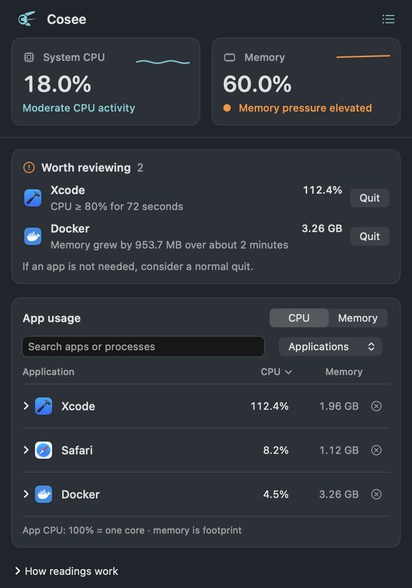

# Cosee

A macOS menu bar companion based on RunCat Neo. Its original Core probe changes flight state and moves faster as system CPU activity grows; the dashboard shows which applications use CPU and memory, their helper processes, and evidence to help you decide what to manage.

## Preview



This preview uses fixture readings. [Korean preview](docs/screenshots/dashboard-ko.png) · [Design and motion](docs/design/README.md)

## Original companion

Cosee uses an original Core probe: a crescent aperture, unequal observation vanes, and flowing propulsion ribbons. Low, moderate and high CPU activity select floating, forward flight and boost states, each with 32 frames and continuous 12–48fps movement. It replaces the cat as the default for new installations and appears in the app icon and dashboard. See [the design sheet and motion preview](docs/design/README.md). Existing saved character choices are preserved; choose **Core probe** in Settings to switch. Regenerate artwork with `swift scripts/generate-orbit.swift`.

## First version

- Separate system overview, review signals, and app-usage sections on an opaque background. Compact CPU/memory columns, search, sorting, expandable process details and trend charts.
- Regular and standalone menu bar apps are recognized. Helpers are grouped by parent ancestry, with unambiguous bundle paths as fallback. Unmatched processes stay visible separately.
- Three-second default sampling (configurable to 3, 5 or 10 seconds) and up to five minutes of history in memory.
- Evidence for CPU usage above 80% of one core for at least 60 seconds, significant memory use during elevated system pressure, or a two-minute footprint increase of at least 256 MiB and 20%. Growth requires complete readings and does not establish a memory leak; active work can explain these signals.
- Confirmed normal quit requests for eligible applications, with exit verification. The target app can prompt to save or decline to quit.
- Local privacy information and bundled open source notices.

System cards, runner selection, custom runners/metrics, and menu bar metric settings from the upstream baseline remain available. Login-item approval or failure is surfaced in Settings.

On Intel Macs with multiple displays, the runner uses a static frame to avoid blank secondary menu bars and overlapping frames. Single-display Intel and Apple Silicon keep layer animation. Intel display transitions still need hardware verification.

CPU uses one core = 100%, so an app can exceed 100%. Memory is the sum of process footprints and can differ from Activity Monitor accounting. `≥` marks a partial total; `—` marks unavailable or initial readings. Browsers' individual tabs and unrelated system services cannot always be attributed to an app.

## Requirements and development

Targets macOS 26+. Use Xcode 26.5 or later and its Swift 6.2+ toolchain. The current development machine is macOS 27.0.1 on Apple Silicon. Packages build for Apple Silicon and Intel; macOS 26 and Intel runtime checks remain release gates.

```sh
make build     # Build Debug Cosee.app
make run       # Build, locally sign, and open the menu bar app
make test      # Run Swift Testing suites
make audit-runner # Verify live Core probe load states and CPU-driven animation
make package   # Build Release and create local ZIP and DMG packages
```

The Xcode shell is `Cosee.xcodeproj` and `Cosee/`. Source lives in `LocalPackage/Sources/`: `DataSource` contains entities and system boundaries, `Model` contains sampling, grouping, insights and stores, and `UserInterface` contains SwiftUI screens and resources. `ProcessBridge` wraps read-only macOS process APIs. Tests live in `LocalPackage/Tests/`. Follow `ARCHITECTURE.md` and `CODING_STYLE.md`; new code uses four-space indentation and the bundled `swift-format` configuration.

`make format` and `make lint` use Xcode's `swift-format`. Dependency versions are locked in `Package.resolved`. `scripts/build.sh` bundles notices from the resolved dependency licenses without a third-party build plugin.

See [the multi-agent audit](docs/AUDIT.md) for verified behavior, fixes, and remaining release checks. Debug previews in `artifacts/dashboard-audit-*.png` use fixture readings, not live process measurements.

## Distribution

Use [the release guide](docs/DISTRIBUTION.md) for Developer ID signing, Apple notarization, and clean-machine acceptance checks. `make package` creates **local development artifacts**, not public releases. `make release` creates notarized ZIP and DMG artifacts after your signing identity and Keychain notarization profile are configured. It does not publish them.

Configuration and imported data use the `io.cosee.mac` preferences domain and `~/Library/Application Support/Cosee`. Resource readings stay on the Mac; there is no analytics or automatic update service. See [privacy information](docs/PRIVACY.md).

## Origin and license

Derived from [RunCat Neo](https://github.com/runcat-dev/RunCatNeo), baseline `b3b1543049ea0a051ecb78654a45f144724ea737`, by Takuto Nakamura. Original copyrights and Apache-2.0 headers are retained. Cosee is an independent derivative. See `LICENSE`, `NOTICE`, and the notices bundled in the app. Modified upstream source files identify the Cosee changes.
