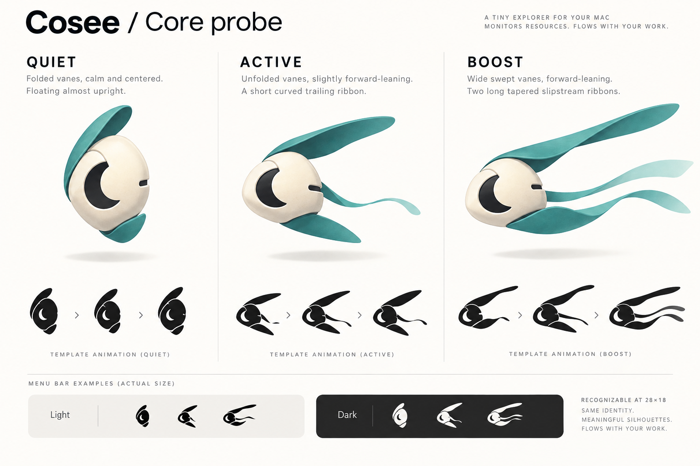

# Cosee — Core probe

위성 공전 중심의 첫 시안을 발전시킨 **코어를 품은 관측 탐사체**다. 초승달 형태의 코어 창과 길이가 다른 관측 날개가 특징이며, 부하에 따라 몸의 실루엣과 움직임이 바뀐다.



## 세 가지 동작

| 여유 · 부유 | 활동 · 전진 | 고부하 · 추진 |
| --- | --- | --- |
|  |  |  |
| 날개를 접고 천천히 흔들린다. | 날개를 펼치고 짧은 리본을 남긴다. | 넓은 날개와 두 추진 리본으로 비행한다. |

- 각 상태는 **32프레임**이다. CPU 활동에 따라 기본 12fps에서 최대 48fps까지 연속적으로 빨라진다.
- 최초 선택은 전체 CPU 15%·55% 기준으로 상태를 결정한다. 이후에는 경계에서 ±3% 여유를 두어 상태가 반복해서 바뀌는 것을 줄인다.
- 상태와 속도가 바뀔 때 재생 위치를 유지한다. 높은 CPU는 바쁜 작업을 뜻하며 위험이나 고장으로 표현하지 않는다.
- 메뉴 막대에는 **28×18pt 흑백 template**을 사용한다. macOS의 밝고 어두운 배경에 맞춰 색이 바뀐다.
- macOS의 동작 줄이기를 켜면 정지 프레임을 사용한다. Intel 다중 화면도 정지 프레임을 사용하며 실제 해당 하드웨어 검증은 남아 있다.

GIF는 각 상태를 비교하는 참고 자료다. 실제 앱은 측정 스트림에 따라 속도를 바꾸고, 사용자가 역속도 옵션을 켜면 속도 변화 방향도 반대로 적용한다.

## 화면의 정보 순서

1. **시스템 요약:** 전체 CPU·메모리 수치, 최근 추이, OS 메모리 압박.
2. **확인할 항목:** 지속 CPU 사용 또는 메모리 변화의 근거와 일반 종료 버튼. 작업 중인 앱을 자동으로 종료하지 않는다.
3. **앱별 사용량:** 앱 이름·CPU·메모리를 고정 열로 비교한다. 검색, 정렬, 앱/전체 프로세스 범위를 선택한다. PID·보조 프로세스·추이는 펼쳐서 확인한다.
4. **측정 방식·시스템 상세:** 계산 기준과 추가 시스템 정보를 별도 섹션으로 제공한다.

불투명한 시스템 배경으로 뒤쪽 화면의 색과 글자가 비치지 않게 한다. 정상 행의 반복 설명을 줄이고 관리 판단의 근거를 별도 섹션에 모았다. 앱 CPU의 `100% = 코어 1개` 기준을 표 아래에 표시한다.

## 생성과 검증

컨셉 이미지는 내장 **imagegen**으로 생성했다. 실제 프레임과 아이콘은 새 CoreGraphics 도형으로 작성한 원본이며, 컨셉 이미지를 자르거나 수정한 결과가 아니다. 이미지 생성 프롬프트는 [core-probe-prompt.txt](core-probe-prompt.txt)에 기록했다.

```sh
swift scripts/generate-orbit.swift
make audit-runner
```

프레임: `LocalPackage/Sources/UserInterface/Resources/Media.xcassets/Runners/Orbit/`. 아이콘: `Cosee/AppIcon.icon/Assets/core-probe.png`. 기존 설정 호환을 위해 내부 ID `orbit`을 유지하고 화면에는 **코어 탐사체 / Core probe**로 표시한다.

새 설치의 기본 캐릭터이며, 일반 업그레이드에서는 저장된 캐릭터 선택을 유지한다. 원본 캐릭터를 선택할 수도 있다. 첫 위성 공전 시안은 `orbit-concept.png`와 `orbit-motion.gif`에 보관한다.
